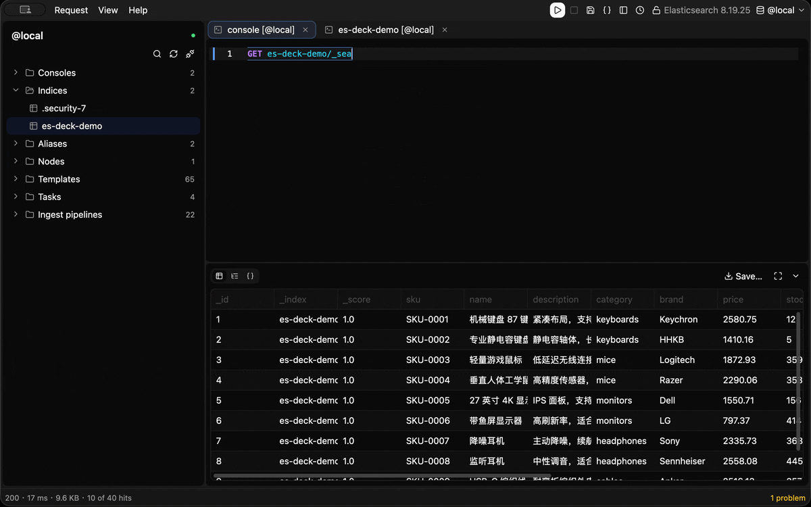

# Elasticsearch Deck

English | [简体中文](README.zh-CN.md)

A native desktop client for Elasticsearch focused on writing REST requests and Query DSL quickly:
schema-driven completion, request execution and result browsing in one place.

Built in Rust on [GPUI Kit](https://gpui-kit.com/).

> **Status:** early development (pre-1.0). The console, completion engine, connection management and
> response views work, but there are no packaged releases yet and cross-platform behavior is still
> being verified. Expect breaking changes.



## Why another Elasticsearch client?

Kibana Dev Tools requires Kibana and cannot keep a library of request scripts offline. IDE plugins
are tied to the host editor. Browser consoles struggle with large result sets. This project is a
standalone app for the two things that matter when exploring a cluster: **typing requests with good
completion** and **looking at the response**.

## Features

### Console

- Kibana Console–style documents: `METHOD /path` plus an optional JSON body, with several request
  blocks in one document.
- Run only the request under the cursor with <kbd>Cmd/Ctrl</kbd>+<kbd>Enter</kbd>; cancel an
  in-flight request; per-connection timeout.
- Console tabs within the active connection. The editor draft is autosaved and restored on
  restart; every console is saved per connection and listed in the sidebar, where it can be renamed
  or deleted.
- Body formatting and JSON syntax highlighting.

### Completion

Completion is generated from the official
[`elasticsearch-specification`](https://github.com/elastic/elasticsearch-specification), not from
hand-written keyword tables, and is filtered by the connected cluster's version.

- **Request line:** HTTP methods, path segments and query-string parameters.
- **JSON body:** keys, enums and boolean values; object and array properties insert `{}` / `[]` with
  the caret inside.
- **Field names:** read from the live index mapping and filtered by clause semantics — `range`
  offers numeric/date fields, `match` analyzed fields, `sort` sortable fields, and nested fields are
  offered only inside the matching `nested` clause.
- **Index and alias names**, including `_index` in `_bulk` actions and `index` in `_msearch`
  headers.
- **NDJSON-aware** completion for `_bulk` and `_msearch`.
- **Tolerant parsing:** works on incomplete JSON and unfinished request lines.
- **Ranking:** exact match, then prefix, then fuzzy subsequence.
- **Version-aware:** candidates newer than the cluster are hidden; the spec index for the cluster's
  version is downloaded on connect and cached (a bundled 8.19 index is the offline fallback).
- <kbd>Ctrl</kbd>+<kbd>Space</kbd> opens the menu on demand.

### Diagnostics and hover

- Live diagnostics for unknown or too-new keys and query parameters, unknown endpoints, deprecated
  keys and JSON syntax errors.
- Hover shows a property's type, description, default, `since` version and deprecation; hovering the
  request line shows the endpoint and its URLs.

### Responses

- `_search` responses render as a table of `_id`, `_index`, `_score` and the union of `_source`
  keys.
- The table sorts on a header click, hides columns from a menu, and opens a row's whole document
  beside it. Sorting applies to the rows already returned; it never rewrites your request.
- Any JSON response can also be viewed as a collapsible tree with JSONPath-style paths and
  **Copy path**, or as raw JSON.
- **Save…** writes the complete response body, not just the part shown in the viewer, and adds a
  `.json` extension when you leave one off.
- The response panel can be collapsed or maximized while reading data.

### Cluster sidebar

- Consoles, indices, aliases, nodes, index templates, running tasks and ingest pipelines.
- Filter, refresh and disconnect; double-clicking an index or alias opens (or creates) its console.

### Safety

- Credentials (password, API key, bearer token) are stored **only in the OS keychain**, never in
  config files, logs or history.
- **Readonly mode** blocks writes using endpoint semantics, so `POST _search` still runs.
- Destructive requests (`DELETE`, `_delete_by_query`, `_update_by_query`, `_close`, `_forcemerge`,
  a `_bulk` containing `delete`) require confirmation.
- No telemetry, no data uploaded anywhere except the cluster you connect to.
- Light, dark and follow-system themes.

## Getting started

### Requirements

- A Rust toolchain. [`rust-toolchain.toml`](rust-toolchain.toml) pins Rust 1.100.0; rustup installs
  it automatically.
- macOS: Xcode command line tools.
- Linux: the GPUI Kit system dependencies (X11/Wayland, `libxkbcommon`, `libxcb`). Linking the app
  and its tests is known to need the `libxkbcommon-x11`, `libxcb-xkb` and `libx11-xcb` development
  packages.
- Windows: an MSVC Rust toolchain.

### Build and run

```bash
git clone https://github.com/JoeHe0x/elasticsearch-deck.git
cd elasticsearch-deck
cargo run -p es-deck
```

On first launch, choose **Connect…** in the title bar and enter the cluster URL, authentication
method and optional TLS settings. The schema index for the cluster version is fetched on connect and
cached, so later launches do not download it again.

### Shortcuts

| Action | macOS | Windows / Linux |
|---|---|---|
| Run the request at the cursor | `Cmd+Enter` | `Ctrl+Enter` |
| Format the request body | `Cmd+Shift+F` | `Ctrl+Shift+F` |
| Show completions | `Ctrl+Space` | `Ctrl+Space` |
| Next / previous tab | `Ctrl+Tab` / `Ctrl+Shift+Tab` | `Ctrl+Tab` / `Ctrl+Shift+Tab` |
| Close tab | `Cmd+W` | `Ctrl+W` |

<kbd>Enter</kbd> accepts a completion and <kbd>Esc</kbd> dismisses the menu.

## Configuration

Everything lives in the platform config directory under `elasticsearch-deck/`:

| Platform | Directory |
|---|---|
| macOS | `~/Library/Application Support/elasticsearch-deck/` |
| Linux | `$XDG_CONFIG_HOME/elasticsearch-deck/` (usually `~/.config/…`) |
| Windows | `%APPDATA%\elasticsearch-deck\` |

| File | Contents |
|---|---|
| `connections.json` | Names, URLs, auth kind, user, CA path and timeout — **no secrets** |
| `appearance.json` | `system`, `light` or `dark` |
| `saved.json` | Saved consoles, per connection |
| `history.json` | Recent requests per connection |
| `draft.txt` | The editor text restored on the next launch |
| `index-<branch>.json` | Cached schema index for a cluster version |

Secrets go to the OS keychain under the service name `elasticsearch-deck`, with the connection name
as the account. Requests touching `_security` or `_xpack` are not recorded in history or saved
consoles; other request bodies are stored as typed.

## Architecture

```text
┌──────────────────────── es-deck (GPUI Kit UI) ────────────────────────┐
│ console tabs · request editor · response views · cluster sidebar      │
└───────────┬───────────────────────────────┬───────────────────────────┘
            │ in-process LSP                │ HTTP + cluster metadata
   ┌────────▼─────────┐             ┌───────▼────────┐
   │ es-dsl-lsp       │             │ es-client      │
   │ completion,      │             │ auth, TLS,     │
   │ hover,           │             │ timeout,       │
   │ diagnostics      │             │ cancellation   │
   └────────┬─────────┘             └───────┬────────┘
            │                                │
   ┌────────▼─────────┐             ┌───────▼────────┐
   │ es-dsl-core      │             │ Elasticsearch  │
   │ parser, JSON     │             │ cluster        │
   │ paths, schema,   │             └────────────────┘
   │ completion,      │
   │ diagnostics      │
   └──────────────────┘
```

Live index mappings reach the engine through the `Fields` trait; `es-dsl-core` performs no I/O.

| Crate | Responsibility |
|---|---|
| [`es-dsl-core`](crates/es-dsl-core) | UI- and network-free engine: request splitting, tolerant JSON paths, schema index, completion, hover, diagnostics, safety classification |
| [`es-dsl-lsp`](crates/es-dsl-lsp) | LSP adapter over stdio; also used in-process by the app |
| [`es-client`](crates/es-client) | Raw HTTP requests, auth, TLS, timeouts, cancellation, cluster metadata cache, hits/tree parsing, history storage |
| [`es-deck-schema`](crates/es-deck-schema) | Converts the official `schema.json` into the compact per-version index |
| [`es-deck`](crates/es-deck) | GPUI Kit UI and application state |

Rules the code base keeps:

- Dependencies point one way: `es-deck` → `es-dsl-lsp` / `es-client` → `es-dsl-core`. The core and the
  client have no UI dependency.
- Completion logic exists once. The in-app editor and external LSP clients use the same server.
- Network requests, schema loading and large JSON processing never block the UI thread.

## Standalone LSP server

The same completion engine can run as a language server over stdio:

```bash
# Convert the official specification into an index
cargo run --release -p es-deck-schema -- schema.json index.json

# Serve completion, hover and diagnostics
cargo run --release -p es-dsl-lsp -- index.json 8.19.0
```

The second argument is the cluster version used for filtering; omit it to disable version filtering.
No editor extension ships with this project yet.

### Regenerating the bundled index

```bash
curl -LO https://raw.githubusercontent.com/elastic/elasticsearch-specification/8.19/output/schema/schema.json
cargo run --release -p es-deck-schema -- schema.json crates/es-deck/assets/index-8.19.json
```

The app normally downloads the index matching the connected cluster and caches it. The bundled file
is used until that download succeeds, or when it fails.

## Testing

```bash
cargo test --workspace
cargo clippy --workspace --all-targets -- -D warnings
cargo fmt --all -- --check
```

The completion and diagnostic benchmark cases are derived from the official documentation and
require the real specification, which is too large to commit:

```bash
curl -LO https://raw.githubusercontent.com/elastic/elasticsearch-specification/8.19/output/schema/schema.json
ES_SPEC_SCHEMA=$PWD/schema.json cargo test -p es-deck-schema --test completion_cases
ES_SPEC_SCHEMA=$PWD/schema.json cargo test -p es-deck-schema --test diagnostic_cases
```

Without `ES_SPEC_SCHEMA` these tests report that they did nothing, so a plain `cargo test` does not
exercise them.

Additional coverage includes table-driven engine tests, `proptest` fuzzing of arbitrary JSON
prefixes, in-memory LSP end-to-end tests and GPUI Kit headless editor tests.

## Documentation

- [`docs/PRD.md`](docs/PRD.md) — product requirements (Chinese)
- [`docs/m0-findings.md`](docs/m0-findings.md) — prototype findings, verified APIs and known gaps
  (Chinese)
- [`docs/data-browser.md`](docs/data-browser.md) — Data Browser design; first version implemented, not yet production-grade
  (Chinese)
- [`docs/gpui-kit.md`](docs/gpui-kit.md) — GPUI Kit development rules (Chinese)

## Platform status

macOS is the current development platform. Windows and Linux builds are intended but not yet
verified end to end. Chinese IME behavior in the editor (preedit and candidate-window positioning)
is still an open M0 validation item; see [`docs/m0-findings.md`](docs/m0-findings.md).

## License and trademark

Licensed under either of MIT or Apache-2.0, at your option.

This project is not affiliated with or endorsed by Elastic. Elasticsearch is a trademark of
Elastic N.V.; the name will be reviewed against Elastic's trademark policy before a formal release.
