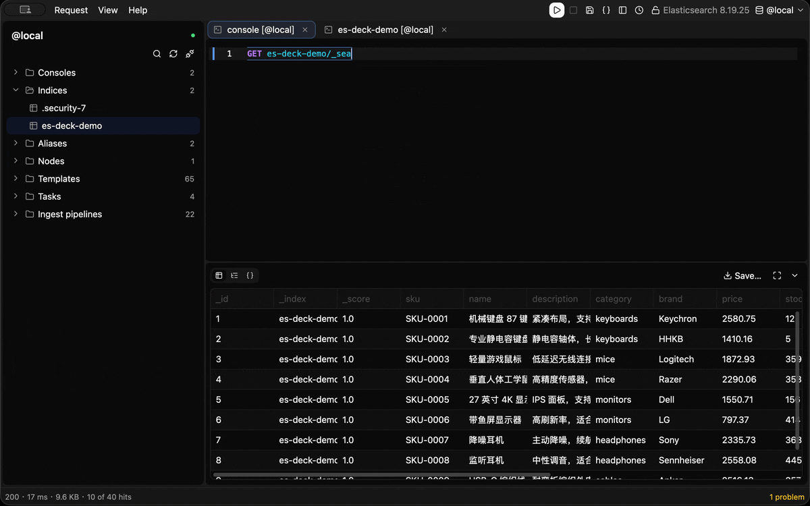

# Elasticsearch Deck

[English](README.md) | 简体中文

一个专注于快速编写 REST 请求和 Query DSL 的原生 Elasticsearch 桌面客户端：schema 驱动的补全、
请求执行和结果浏览都在一处完成。

基于 [GPUI Kit](https://gpui-kit.com/) 用 Rust 构建。

> **状态：** 早期开发阶段（pre-1.0）。控制台、补全引擎、连接管理和响应视图已经可用，但还没有
> 打包发布，跨平台行为仍在验证中。预期会有破坏性变更。



## 为什么还要另一个 Elasticsearch 客户端？

Kibana Dev Tools 依赖 Kibana，无法离线保存请求脚本库。IDE 插件被绑定在宿主编辑器上。浏览器控制
台难以应对大数据量结果集。本项目是一个独立应用，专注于探索集群时最重要的两件事：**带良好补全的
请求输入**和**查看响应**。

## 功能

### 控制台

- Kibana Console 风格的文档：`METHOD /path` 加可选 JSON body，一个文档里可以包含多个请求块。
- 用 <kbd>Cmd/Ctrl</kbd>+<kbd>Enter</kbd> 只运行光标所在的请求；可取消进行中的请求；按连接设置
  超时。
- 当前连接内的控制台标签页。编辑器草稿自动保存并在重启后恢复；每个控制台按连接保存并显示在侧边
  栏，可以重命名或删除。
- Body 格式化和 JSON 语法高亮。

### 补全

补全由官方
[`elasticsearch-specification`](https://github.com/elastic/elasticsearch-specification) 生成，
而不是手写关键字表，并按所连接集群的版本过滤。

- **请求行：** HTTP 方法、路径段和 query string 参数。
- **JSON body：** 键、枚举和布尔值；对象和数组属性会插入 `{}` / `[]`，光标置于内部。
- **字段名：** 从实时索引 mapping 读取，并按子句语义过滤——`range` 提供数值/日期字段，`match`
  提供分词字段，`sort` 提供可排序字段，nested 字段只在对应的 `nested` 子句内提供。
- **索引和别名名称**，包括 `_bulk` action 里的 `_index` 和 `_msearch` 头里的 `index`。
- **NDJSON 感知**补全，适用于 `_bulk` 和 `_msearch`。
- **容错解析：** 对不完整的 JSON 和未完成的请求行同样可用。
- **排序：** 精确匹配，其次前缀，再次模糊子序列。
- **版本感知：** 比集群版本更新的候选会被隐藏；连接时下载并缓存该集群版本的 spec 索引（内置
  8.19 索引作为离线回退）。
- <kbd>Ctrl</kbd>+<kbd>Space</kbd> 按需打开补全菜单。

### 诊断与悬停

- 实时诊断：未知或版本过新的键和 query 参数、未知 endpoint、已弃用的键以及 JSON 语法错误。
- 悬停显示属性类型、描述、默认值、`since` 版本和弃用信息；悬停在请求行上显示 endpoint 及其
  URL。

### 响应

- `_search` 响应渲染为表格，列包括 `_id`、`_index`、`_score` 以及 `_source` 键的并集。
- 表格可以点击表头排序、用列菜单隐藏列，点击行在右侧查看完整文档。排序只作用于已经返回的
  行，不改写你的请求。
- 任意 JSON 响应也可以查看为可折叠树（带 JSONPath 风格路径和 **Copy path**），或查看原始
  JSON。
- **Save…** 保存完整响应体，而不只是查看器里显示的部分；没写扩展名时自动补 `.json`。
- 阅读数据时，响应面板可以折叠或最大化。

### 集群侧边栏

- Consoles、indices、aliases、nodes、index templates、运行中的 tasks 和 ingest pipelines。
- 过滤、刷新和断开连接；双击索引或别名会打开（或创建）它的控制台。

### 安全

- 凭据（密码、API key、bearer token）**只存储在操作系统钥匙串**中，绝不写入配置文件、日志或
  历史记录。
- **只读模式**按 endpoint 语义拦截写操作，因此 `POST _search` 仍可运行。
- 破坏性请求（`DELETE`、`_delete_by_query`、`_update_by_query`、`_close`、`_forcemerge`、
  包含 `delete` 的 `_bulk`）需要二次确认。
- 无遥测，除你连接的集群外不向任何地方上传数据。
- 浅色、深色和跟随系统主题。

## 快速开始

### 环境要求

- Rust 工具链。[`rust-toolchain.toml`](rust-toolchain.toml) 固定 Rust 1.100.0；rustup 会自动
  安装。
- macOS：Xcode command line tools。
- Linux：GPUI Kit 的系统依赖（X11/Wayland、`libxkbcommon`、`libxcb`）。已知链接应用及其测试
  需要 `libxkbcommon-x11`、`libxcb-xkb` 和 `libx11-xcb` 开发包。
- Windows：MSVC Rust 工具链。

### 构建和运行

```bash
git clone https://github.com/JoeHe0x/elasticsearch-deck.git
cd elasticsearch-deck
cargo run -p es-deck
```

首次启动时，在标题栏选择 **Connect…**，输入集群 URL、认证方式和可选的 TLS 设置。连接时会获取该
集群版本对应的 schema 索引并缓存，之后启动不再重复下载。

### 快捷键

| 操作 | macOS | Windows / Linux |
|---|---|---|
| 运行光标处的请求 | `Cmd+Enter` | `Ctrl+Enter` |
| 格式化请求 body | `Cmd+Shift+F` | `Ctrl+Shift+F` |
| 显示补全 | `Ctrl+Space` | `Ctrl+Space` |
| 下一个 / 上一个标签页 | `Ctrl+Tab` / `Ctrl+Shift+Tab` | `Ctrl+Tab` / `Ctrl+Shift+Tab` |
| 关闭标签页 | `Cmd+W` | `Ctrl+W` |

<kbd>Enter</kbd> 接受补全，<kbd>Esc</kbd> 关闭菜单。

## 配置

所有内容都存放在平台配置目录下的 `elasticsearch-deck/`：

| 平台 | 目录 |
|---|---|
| macOS | `~/Library/Application Support/elasticsearch-deck/` |
| Linux | `$XDG_CONFIG_HOME/elasticsearch-deck/`（通常是 `~/.config/…`） |
| Windows | `%APPDATA%\elasticsearch-deck\` |

| 文件 | 内容 |
|---|---|
| `connections.json` | 名称、URL、认证类型、用户、CA 路径和超时——**不含密钥** |
| `appearance.json` | `system`、`light` 或 `dark` |
| `saved.json` | 按连接保存的控制台 |
| `history.json` | 每个连接的最近请求 |
| `draft.txt` | 下次启动时恢复的编辑器文本 |
| `index-<branch>.json` | 按集群版本缓存的 schema 索引 |

密钥存放在操作系统钥匙串中，服务名为 `elasticsearch-deck`，账户名为连接名。访问 `_security` 或
`_xpack` 的请求不会记入历史或保存的控制台；其他请求体按输入内容原样存储。

## 架构

```text
┌──────────────────────── es-deck (GPUI Kit UI) ────────────────────────┐
│ console tabs · request editor · response views · cluster sidebar      │
└───────────┬───────────────────────────────┬───────────────────────────┘
            │ in-process LSP                │ HTTP + cluster metadata
   ┌────────▼─────────┐             ┌───────▼────────┐
   │ es-dsl-lsp       │             │ es-client      │
   │ completion,      │             │ auth, TLS,     │
   │ hover,           │             │ timeout,       │
   │ diagnostics      │             │ cancellation   │
   └────────┬─────────┘             └───────┬────────┘
            │                                │
   ┌────────▼─────────┐             ┌───────▼────────┐
   │ es-dsl-core      │             │ Elasticsearch  │
   │ parser, JSON     │             │ cluster        │
   │ paths, schema,   │             └────────────────┘
   │ completion,      │
   │ diagnostics      │
   └──────────────────┘
```

实时索引 mapping 通过 `Fields` trait 进入引擎；`es-dsl-core` 不执行任何 I/O。

| Crate | 职责 |
|---|---|
| [`es-dsl-core`](crates/es-dsl-core) | 无 UI、无网络依赖的引擎：请求切分、容错 JSON 路径、schema 索引、补全、悬停、诊断、安全分类 |
| [`es-dsl-lsp`](crates/es-dsl-lsp) | stdio 上的 LSP 适配层；应用内也以进程内方式使用 |
| [`es-client`](crates/es-client) | 原始 HTTP 请求、认证、TLS、超时、取消、集群元数据缓存、hits/tree 解析、历史存储 |
| [`es-deck-schema`](crates/es-deck-schema) | 把官方 `schema.json` 转换为紧凑的按版本索引 |
| [`es-deck`](crates/es-deck) | GPUI Kit UI 与应用状态 |

代码库遵循的规则：

- 依赖单向：`es-deck` → `es-dsl-lsp` / `es-client` → `es-dsl-core`。core 和 client 不依赖 UI。
- 补全逻辑只有一份。应用内编辑器和外部 LSP 客户端使用同一个 server。
- 网络请求、schema 加载和大 JSON 处理绝不阻塞 UI 线程。

## 独立 LSP 服务

同一个补全引擎可以作为语言服务器通过 stdio 运行：

```bash
# 把官方 specification 转换为索引
cargo run --release -p es-deck-schema -- schema.json index.json

# 提供补全、悬停和诊断
cargo run --release -p es-dsl-lsp -- index.json 8.19.0
```

第二个参数是用于过滤的集群版本；省略则关闭版本过滤。本项目目前不提供编辑器扩展。

### 重新生成内置索引

```bash
curl -LO https://raw.githubusercontent.com/elastic/elasticsearch-specification/8.19/output/schema/schema.json
cargo run --release -p es-deck-schema -- schema.json crates/es-deck/assets/index-8.19.json
```

应用通常会下载与所连接集群匹配的索引并缓存。该下载成功之前，或下载失败时，使用内置文件。

## 测试

```bash
cargo test --workspace
cargo clippy --workspace --all-targets -- -D warnings
cargo fmt --all -- --check
```

补全和诊断的基准用例来自官方文档，需要真实的 specification，文件太大无法提交：

```bash
curl -LO https://raw.githubusercontent.com/elastic/elasticsearch-specification/8.19/output/schema/schema.json
ES_SPEC_SCHEMA=$PWD/schema.json cargo test -p es-deck-schema --test completion_cases
ES_SPEC_SCHEMA=$PWD/schema.json cargo test -p es-deck-schema --test diagnostic_cases
```

没有 `ES_SPEC_SCHEMA` 时这些测试会报告自己什么都没做，所以普通的 `cargo test` 不会执行它们。

额外覆盖包括表驱动的引擎测试、对任意 JSON 前缀的 `proptest` 模糊测试、内存内 LSP 端到端测试和
GPUI Kit 无头编辑器测试。

## 文档

- [`docs/PRD.md`](docs/PRD.md) — 产品需求（中文）
- [`docs/m0-findings.md`](docs/m0-findings.md) — 原型验证结论、已验证的 API 和已知缺口（中文）
- [`docs/data-browser.md`](docs/data-browser.md) — Data Browser 设计；首版已实现，尚未达到产品水准（中文）
- [`docs/gpui-kit.md`](docs/gpui-kit.md) — GPUI Kit 开发规则（中文）

## 平台状态

macOS 是当前的开发平台。Windows 和 Linux 构建是目标，但尚未端到端验证。编辑器的中文输入法行为
（预编辑和候选窗定位）仍是 M0 待验证项；见 [`docs/m0-findings.md`](docs/m0-findings.md)。

## 许可证与商标

在 MIT 或 Apache-2.0 两者中任选其一授权。

本项目与 Elastic 无关联，也未获其背书。Elasticsearch 是 Elastic N.V. 的商标；正式发布前会按
Elastic 的商标政策复核名称。
